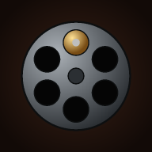
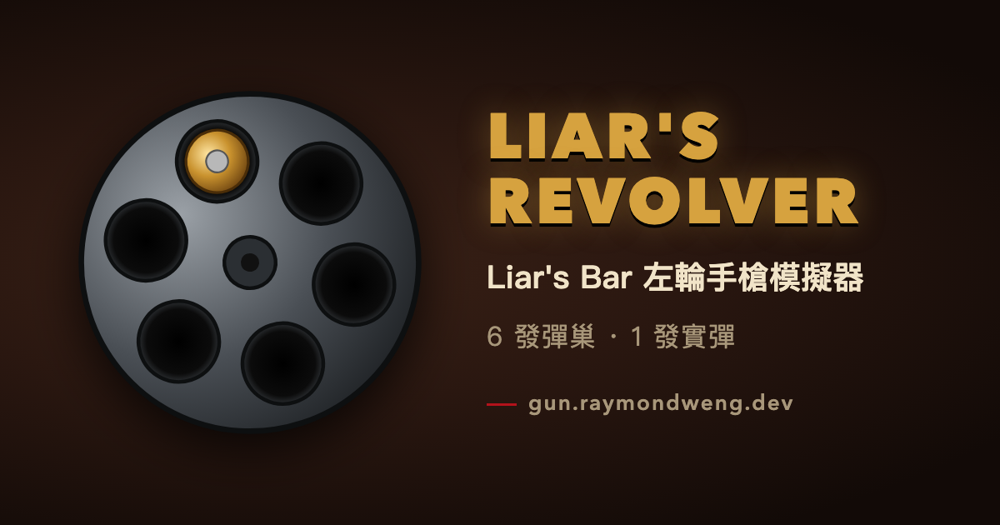

<div align="center">



# Liar's Revolver

**模擬 Liar's Bar 的左輪手槍** — 6 發彈巢、1 發實彈，扣下扳機看你的運氣。

[](https://gun.raymondweng.dev)


[](LICENSE)



</div>

---

## 🎯 玩法

每次裝填會隨機決定實彈位置。扣下扳機後轉到下一格、**不會重新轉輪**，所以中彈機率會一發比一發高：

| 第幾發 | 1 | 2 | 3 | 4 | 5 | 6 |
| :--- | :-: | :-: | :-: | :-: | :-: | :-: |
| **機率** | 1/6 | 1/5 | 1/4 | 1/3 | 1/2 | **1/1** 💀 |

- 🔄 **重新裝填**：遊戲中要按住約 0.8 秒；中彈後前 1 秒不能按（防誤觸）
- 💾 **自動存檔**：重新整理或關掉再開，會接著上一局

### ⌨️ 桌機快捷鍵

| 按鍵 | 動作 |
| :--- | :--- |
| <kbd>Space</kbd> / <kbd>Enter</kbd> | 扣扳機 |
| <kbd>Space</kbd> / <kbd>Enter</kbd> / <kbd>R</kbd> | 中彈後重新裝填 |

> [!TIP]
> iPhone 記得關掉**靜音開關**才聽得到槍聲。

## ✨ 特色

- 🪶 **純靜態網站** — 無 build 步驟、無相依套件
- 🎲 **公平的隨機** — 使用 `crypto.getRandomValues`
- 🔊 **即時合成音效** — Web Audio 產生，不需要音檔
- 📳 **震動回饋** — Android 實體震動；iPhone 改用畫面震動與閃光
- 📱 **PWA** — 可離線使用，可加入主畫面當 App 開
- 🔆 **不自動熄屏** — 優先用 Screen Wake Lock API，舊版 iOS 退回播放隱藏的無聲迴圈影片

## 📁 檔案結構

```
.
├── index.html            頁面
├── style.css             樣式
├── app.js                遊戲邏輯、音效、防熄屏
├── sw.js                 Service Worker 離線快取
├── manifest.webmanifest  PWA 設定
├── icons/                App 圖示、分享預覽圖
├── _headers              HTTP header
└── wrangler.toml         Cloudflare 部署設定
```

## 🛠️ 本機開發

```bash
python3 -m http.server 8000
```

然後打開 <http://localhost:8000>。

> [!IMPORTANT]
> 改完要讓已安裝的使用者拿到新版，記得把 [`sw.js`](sw.js) 的 `CACHE` 版本號加一。

## 📄 License

[MIT](LICENSE)
